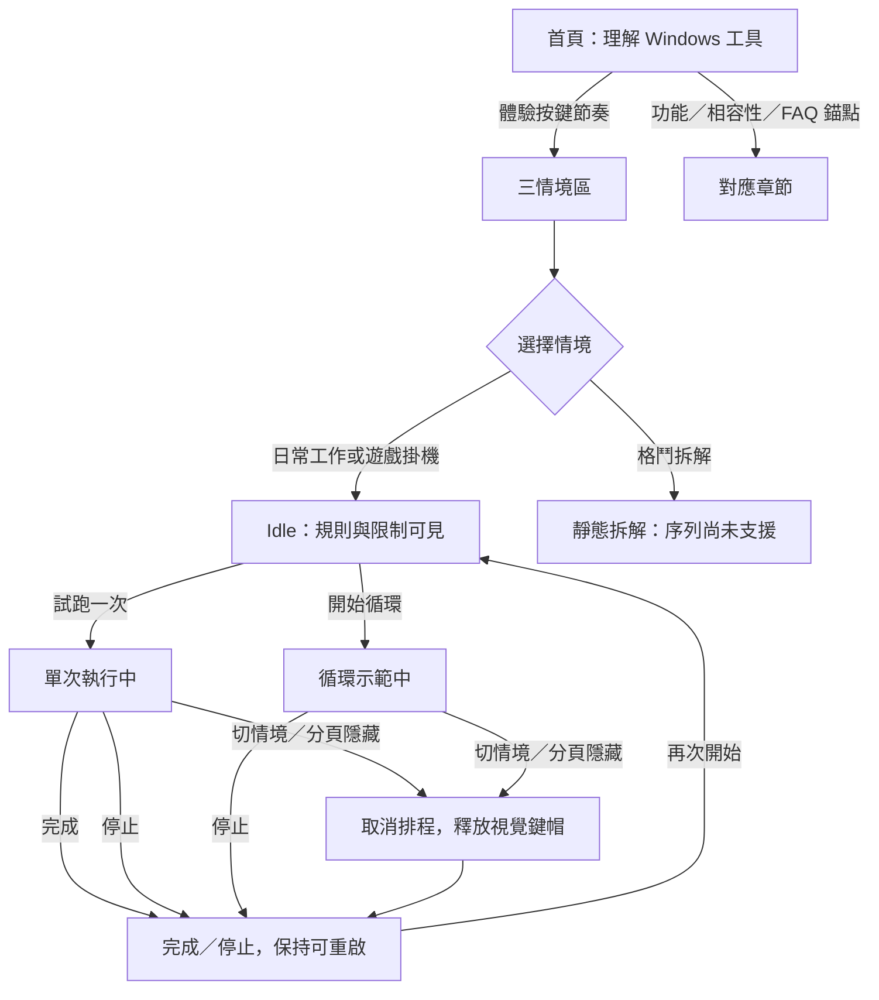

# AutoKey 官網 UI／UX 規格

2026-11-13 推薦工具：Header 的 Navigation Menu 與頁底 Carousel 以 [RT1 規格與來源](recommendations-plan.md) 為準，canonical HTML 在 `design/recommendations-v1/`。沿用 SD1.1；網站名稱＋官方圖示、無網址文字、三語、暫停與手機滑動契約均集中於 RT1。元件引用 Atlas `navigation-menu`／`carousel` 及共享 `navigation-disclosure`／`data-and-media`，不增加套件。

2026-11-13新增：Steam／三語文案與SEO／指定介紹影片的當前設計為[SD1交接](design/steam-download-v1/design-handoff.md)，SD1.1 已依使用者「請直接開發」整合，首屏追加「前往 Steam 下載」。其 Link、Card、Video Player 決策、全部狀態與尺寸集中於該交接；正式來源已採用 SD1.1。後續正式整合不得以本歷史版的「商店待公告」取代已核實的Steam狀態。

歷史版本：2026-10-22起正式來源已依使用者確認的[D1交接規格](design/redesign-v1/design-handoff.md)整合。以下保留原版決策，不作新版視覺驗收基準。

2026-09-25；單一採用版本：**按鍵節奏台**。對應 plan.md 的 US-S1–4／FR-S1–6。正式頁面由此規格實作，沒有另外一套 prototype。沿用桌面品牌資產與使用者已選石墨＋薄荷綠。

## 目的與內容邊界

訪客在第一屏理解「Windows 按鍵自動化工具」，接著在頁面內試看連點、長壓與群組節奏，並能分辨真實能力及相容性限制。主行動為「體驗按鍵節奏」，次行動為「了解功能」。網站新增英文／繁中／簡中；31 語系是桌面程式能力。

首頁主標：**把重複按鍵，交給 AutoKey。** 建議分成兩行，AutoKey 保持完整。副文案：「把連點與長壓整理成群組。選定應用程式，用自訂快捷鍵啟動一次，或持續循環。」

相容性區塊必須展開顯示，不能僅藏在 FAQ：

> 背景接收，取決於目標程式。AutoKey 可向指定視窗傳送按鍵訊息；只有本身允許在背景接收並處理這類訊息的程式，才會在切換視窗後繼續回應。可用於接受按鍵訊息的前景視窗，實際相容性依程式而定。

補充：「部分遊戲或程式使用不同的輸入方式，即使保持前景也可能不接受。執行狀態代表正在傳送，不代表目標已採納。」不用「大部分已支援」、相容名單或 Overwatch 2 可用背書。程式不搶回使用者焦點；切回視窗不需要重新按快捷鍵，但鎖定／休眠、目標關閉後的停止規則依桌面說明。

## 視覺決策

### 三語選單追加

頂部品牌同列新增原生 Select，選項以自稱固定為 English／繁體中文／简体中文；旁顯 globe 線條圖示並有翻譯過的 Language 可及標籤。選單立即生效、記住手選；單一選擇值，非命令menu，不使用國旗代替語言。沿用 surface／mint／control-border、14px與最小44px。寬版置品牌與導覽之間；窄版品牌與選單第一列、導覽第二列、示範CTA按空間分列，文字不可省略。

狀態：初始自動偵測／已選；鍵盤focus與原生options；切換後更新整頁lang／title／metadata和demo文字。播放中切換→停止＋新語言原因；非播放切換重設示範，保留情境／FAQ與位置。storage不能保存時仍可用，會用新語言顯示本次有效但下次可能不保留的鄰近提示；無JS不顯示選單，保留既有繁中fallback。

來源：Atlas select（https://huangchiyu.com/Vibe-UI-Atlas/components/select/），本機catalog／`input-and-choice`的單選契約及playbook資料選擇。2026-09-25 嘗試讀取該來源但無法存取，不能宣稱遠端視覺一致。以原生select與label呈現，不引入大型元件庫；延續既有已查核資產與視覺。QA增加英文較長文字、選單上下鍵、持久化及320px排版。

三語調整的 UX 搜尋：`language selector native select` 結果未精確匹配，縮窄為 `select fixed options keyboard` 後只採一般鍵盤可操作指引；語言自稱、原生選單與不放國旗由本次需求及既有控制規則決定，未將搜尋结果當作完整語言選單設計。

主視覺把鍵盤工具的材質感集中在一處：大尺寸 F12 鍵帽、沿軌道排列的訊號短線、精簡程式視窗。其餘區塊使用安靜的文字與分隔線，避免每段都堆卡片與光暈。F12 只是可自訂快捷鍵的例子，旁註「快捷鍵可自訂」；不得寫成唯一固定全域鍵。

### Tokens

| Token | 值／用途 |
| --- | --- |
| `--bg` | `#0C1015` 頁面石墨底，直接沿用 icon 最深色 |
| `--surface` | `#151B22` 面板 |
| `--surface-raised` | `#202A33` 鍵帽、次級容器 |
| `--border` | `#34434D` 裝飾分隔線；必要控制邊界用 `#61737E` |
| `--text` | `#F0F5F3` 標題／正文 |
| `--muted` | `#A9B8BC` 次要正文；不能再降低 opacity |
| `--mint` | `#83EDC9` 主要行動、啟用狀態 |
| `--mint-soft` | `#A1F4D4` hover、焦點環 |
| `--on-mint` | `#10201B` 綠色按鈕文字 |
| `--amber` | `#F1C681` 尚未支援／待驗收文案；不是錯誤紅 |
| `--radius-control/panel` | `10px / 20px`，鍵帽專用 `22px` |
| `--space` | `4 / 8 / 12 / 16 / 24 / 32 / 48 / 64 / 96px` |
| `--content` | `1184px`，頁面左右 `max(24px, (100vw - 1184px)/2)` |
| `--body-font` | `"Segoe UI", "Microsoft JhengHei", "PingFang TC", sans-serif`，不外載 |
| `--utility-font` | `"Cascadia Code", "Consolas", monospace`，用於鍵名與秒數 |
| Hero H1 | desktop `64px/1.18`、weight 750、letter-spacing `-.035em`；mobile `38px/1.24` |
| H2 / H3 | `36px/1.3` / `22px/1.4`；mobile H2 `29px` |
| Body / small | `17px/1.8` / `14px/1.65`；必要標籤至少 14px |
| Motion | hover `160ms`；鍵帽按下 `110ms`；tab 淡入最多 `180ms`，只 transform／opacity |

鍵帽可有 `0 9px 0 #080D11, inset 0 1px 0 #53606B` 實體陰影；hover 不作持續懸浮。唯一低透明薄荷光暈在 hero 視覺後方，面積不超過 hero 右半。不可背景無限閃爍或自動輪播。`prefers-reduced-motion: reduce` 下關閉位移、transition、smooth scroll；按下状態用邊框／文字繼續回饋。

## 整頁布局

### 桌面 ≥ 960px

```text
┌ logo AutoKey       功能  應用情境  相容性  常見問題     體驗示範 ┐
│ Windows 按鍵自動化                 ┌──F12───────┐            │
│ 把重複按鍵，                       │ 快捷鍵可自訂│  節奏軌道   │
│ 交給 AutoKey。                     └────────────┘            │
│ 副文案                             程式縮略介面／功能示意      │
│ [體驗按鍵節奏] [了解功能 →]                                  │
│ 連點與長壓  ·  自訂群組  ·  Windows                           │
├─────────────────────────────────────────────────────────────┤
│ 一次設定，按你的節奏執行         四項功能（2×2、簡潔圖標）    │
├─────────────────────────────────────────────────────────────┤
│ 從日常工作，到遊戲練習                                       │
│ [日常工作] [遊戲掛機] [格鬥指令拆解]                         │
│ 情境說明與規則 40%  │ 模擬目標畫面與鍵帽 60%                │
│                    │ 狀態、[試跑一次] [開始循環／停止示範] │
├─────────────────────────────────────────────────────────────┤
│ 背景接收，取決於目標程式。    前景／背景兩列說明              │
├─────────────────────────────────────────────────────────────┤
│ 開始使用：1 選擇目標 → 2 整理群組 → 3 用快捷鍵啟停          │
├─────────────────────────────────────────────────────────────┤
│ 常見問題（左側標題、右側 disclosure）                        │
├─────────────────────────────────────────────────────────────┤
│ AutoKey · Windows                     Steam 版本準備中       │
└─────────────────────────────────────────────────────────────┘
```

Header 高 80px；以普通頂部導覽為首選，若 sticky 則加入 section `scroll-margin-top: 104px`、不遮焦點。Hero 上下 padding 72／88px，左右 52／48%，column-gap 40px。視覺總高度約 440px，F12 約 132×112px，程式缩图約 440×256px。程式示意只放「工作群組 · F12」「PageDown · 連點 · 2.0 秒」「執行方式 · 循環」等可讀資訊，明標「功能示意」，不可假裝實拍畫面。

Section 間距 96px、章節說明 max-width 640px。功能 4 項：「連點與長壓」「群組與快捷鍵」「執行一次或循環」「31 種桌面介面語言」。不用任意流水號標示不具順序的功能。三步開始使用才使用 1–3。

### 手機 ≤ 639px，平板 640–959px

- 320px 也不可水平溢出；左右 padding 20px（320px 使用 16px）；hero 垂直堆疊，文字先於圖，section gap 64px。主次 CTA 可以兩行，至少高 48px。
- Header 第一列品牌與「體驗示範」短行動，第二列 4 個 anchor link（至少 44px 高）；不引入漢堡選單複雜狀態。錨點文字可適度簡化為「功能／情境／相容性／FAQ」。
- Hero 視覺不裁掉重要字，缩小 F12 為 88×80px，整體縮图留至少 14px 正文；不以 transform 縮整個含文字面板。
- 功能單列或 ≥640px 雙列；情境 tabs 3 等寬、允許兩行文字，全部在同一行且高度隨最長文字增長。各 panel 先說明，再畫面，再動作。模擬 timeline 不做水平拖曳依賴。
- 模擬按鈕兩等寬、可換行。狀態完整換行，禁止 `text-overflow: ellipsis`。FAQ summary 自動高度，44px 為最小值。
- 200% 文字縮放與 320px 下可閱讀完整標題／秒數；短靜態範例不需要搜尋、篩選或巢狀捲動。

## 三情境與互動狀態

所有情境上方固定文案：**「互動示意只在這個網頁內運作，不會控制你的應用程式。」** 無真實 key event 派送、無 OS API、無隱藏背景工作；localStorage 僅存網站語言偏好，不存示範資料。網頁不得攔截 F12；以按鈕觸發，F12 鍵帽是非互動標記。

### 日常工作：讓瀏覽節奏更從容

- 顯示文件／閱讀清單的抽象示意，3–4 個文字段落與目前進度；不冒用 Word／Excel／瀏覽器商標畫面。
- 範例按鍵 `PageDown`、連點、間隔 `2 秒`。說明「在接受 PageDown 的閱讀或檢視工具裡，按設定節奏翻閱內容。」
- 「試跑一次」：立即呈現一次鍵帽按下與下一段高亮，200ms 後完成，status「已完成一次示範」。
- 「開始循環」：立即一次，之後每 2 秒一次；最多顯示最近 4 筆視覺節奏點，不無限增 DOM。按鈕改「停止示範」，停止後保留最後畫面與次數。

### 遊戲掛機：重複操作，交給固定節奏

- 標題／badge 明示「僅限允許自動化的環境」；文案「在允許自動化且接受按鍵訊息的遊戲中，將重複互動整理為按鍵規則。」不承諾繞過限制、不暗示熱門遊戲已實測。
- 模擬抽象遊戲互動儀表，按鍵 `E`、長壓 `1 秒`、間隔 `1 秒`。不要用真實遊戲截图或金幣增值數字暗示實際收益。
- 「試跑一次」：長壓條 1 秒滿後釋放並完成；「開始循環」：長壓 1 秒、休息 1 秒反覆。停止即釋放視覺鍵帽並取消所有排程。
- 旁文顯示「遊戲規則與輸入方式各不相同，請先確認可用範圍。」此為用途邊界，不壓在首屏作警告。

### 格鬥指令拆解：看懂順序與時間

- 固定 amber badge：**「複雜連招尚未支援」**。以方向鍵與攻擊鍵（例如 `↓ → P`）分解「方向輸入 → 按鍵輸入」，只當教學圖。
- 緊鄰示意文案：**「這是指令拆解示意。現版群組內按鍵同時起算，尚未支援依序輸出連招，也不保證組合鍵效果。」**
- 採靜態可讀圖，不提供「試跑一次／開始循環」以免冒充可執行功能；用一般文字「了解現版：連點、長壓與群組控制」連回功能區。若未來增教學播放，必須標成「播放拆解動畫」並重做驗收，本版不增。

### 統一狀態契約

| 狀態 | 畫面回饋 | 可用行動／下一步 |
| --- | --- | --- |
| Idle | 「尚未開始 · 網頁示意」；鍵帽抬起、次數 0 | 試跑一次、開始循環、切情境 |
| Running once | 「單次執行中」；鍵帽／長壓條同步 | 單次按鈕暫不可用，保留停止；切情境即停止 |
| Running loop | 「循環示範中」；顯示次數與節奏 | 同一主按鈕改停止；once 暫不可用且有可見狀態原因 |
| Stopped | 「示範已停止」；鍵帽抬起；保留次數 | 可重新單次或循環，新一輪歸零 |
| Completed | 「已完成一次示範」 | 可再次單次或循環，不自動開始下一輪 |
| Hidden | `visibilitychange` 隱藏時 clear 全部 timer，鍵帽抬起 | 返回仍停止；status「分頁離開時已停止，按開始重新示範」 |
| Scenario change | 先停止所有 timer 再更新 active panel，次數歸零 | 新情境 Idle；焦點留在被選 tab，不跳動 |
| JS unavailable | 情境與限制仍可閱讀，互動區顯示 noscript 提示 | 不顯示可點卻失效的執行控制 |

本地固定內容無 API，因此不虛構 loading、儲存成功、網路錯誤或登入狀態。以 `role=status`／`aria-live=polite` 只宣告狀態改變，頻繁的次數變動不進 live region。切換／停止後不能殘留 timeout 造成幽靈按鍵；同一次啟動只建立一份排程。

## 流程圖



## 元件選型與來源

已讀 orchestrator 交互規範／Atlas 選型、共享 deep playbook、catalog 與 component-pattern-library HTML 對應段落。下列 canonical URL 已於 **2026-09-25** 嘗試用 web 開啟，全部回報 inaccessible；因此採本機 catalog、playbook、共享 HTML 的責任與狀態契約作 fallback。未宣稱已觀看遠端 demo 或像素一致。共享檔案在 `C:/Users/User/.codex/skills/ui-component-demo/references/`，只作團隊參考，不複製进網站。

| 元件／任務 | Atlas canonical／本機 pattern | 本站決策／必要狀態 |
| --- | --- | --- |
| Link：前往章節／真實資源 | [link](https://huangchiyu.com/Vibe-UI-Atlas/components/link/)、`action-feedback` | 原生 `a href`；default/hover/focus。目的地文字清楚，不拿 button 模擬導航；目前不提供假 Steam／download link。 |
| Button：啟動／停止頁內示範 | [button](https://huangchiyu.com/Vibe-UI-Atlas/components/button/)、`action-feedback` | 原生 `button type=button`；ready/focus/running/completed/stopped。副文案緊鄰、不得以 link 代替。連續啟動去重，執行時能停止，必要禁用保留原因。 |
| Tabs：3 個並列情境 | [tabs](https://huangchiyu.com/Vibe-UI-Atlas/components/tabs/)、`navigation-disclosure` | 1 active／2 inactive；`role=tablist/tab/tabpanel`、aria-selected/controls/labelledby；roving tabindex；Left/Right、Home/End 到相應 tab 並選取（本地內容即時）。Space/Enter 可選。禁止用 tabs 表達三步開始使用。 |
| Disclosure：FAQ 可獨立展開 | [disclosure](https://huangchiyu.com/Vibe-UI-Atlas/components/disclosure/)、`navigation-disclosure` | 原生 details/summary；closed/open/focus；Enter/Space 開關，可同時開多項。相容性要點與未上架狀態放在外部，不依賴展開才可知。 |
| Status：示範狀态／發布狀態 | [status-indicator](https://huangchiyu.com/Vibe-UI-Atlas/components/status-indicator/)、`feedback-and-recovery`＋`identity-status` | 純文字＋色點，非可點 badge。Idle/Running/Completed/Stopped 有文字；尚未支援與準備中持續可見。狀態不 toast 自消失，不只有色彩。 |

平台表達為 semantic HTML，鍵盤／觸控／螢幕閱讀器由瀏覽器可及性樹傳達；沒有 modal、picker、搜尋或可編輯設定，本版不需引入大型 UI library。靜態功能區使用 heading/list，開始使用用 ordered list，不把文字卡做成偽控制項。

## FAQ 與取得狀態文案範圍

- 「切換到其他視窗，還能繼續嗎？」：僅在目標接受背景按鍵訊息時有效，不切焦點，不需因切回視窗反覆重新啟動。
- 「為什麼顯示執行中，目標卻沒有反應？」：訊息已送不代表採納，目標輸入方式／權限可能影響；避免承諾管理員模式即可修好。
- 「可以設定一組複雜連招嗎？」：群組內同時起算，尚未支援序列與精確連招；簡單連點／長壓可配置。
- 「桌面程式有哪些語言？」：31 語系；預設跟隨 Windows 顯示語言，找不到用英文；網站提供英文、繁中與簡中。
- 「如何取得程式與 Steam 版？」：Steam 版本準備中，商店與正式下載資訊待公告。本版不設假按鈕，未確認公開 repository 也不引导一般訪客下載 private repo。
- 「設定會同步嗎？」：本機自動保存；Steam Cloud 流程準備中，尚待後台啟用與雙機驗收。不能寫成現有隨時跨機同步。

## QA 驗收清單

落地精修：必要標籤跨尺寸至少 14px；導覽可點寬度至少 44px。手機保留功能／相容性標題的語意換行，標題使用 balanced wrapping，避免末行只剩一個字。沿用本規格的一套 tokens 與資產。

1. 1440×1000、1280×800、768×1024、390×844、320×740 五尺寸驗證無水平溢出、標題完整、hero 不裁重要資訊；留下桌面與手機 screenshot。
2. Tab 鍵遍历 skip link、導覽、CTA、情境、示範控制與 FAQ；focus 2px mint ring＋3px offset 清楚。全部可觸區至少 44×44px，對比正文至少 4.5:1、控制必要邊界至少 3:1。
3. 情境 tabs Arrow/Home/End 正確、只有 active panel 可聚焦；切換立即停止，返回原情境不自行跑。FAQ 原生鍵盤與觸控可展開，內容不截斷。
4. 日常單次恰好一步、循環每 2 秒；遊戲長壓 1 秒釋放後間隔 1 秒；快速連點開始不建立重複 timer；停止及 visibility hidden 取消所有排程。
5. 模擬只改 DOM；F12 不被 preventDefault、不派送 synthetic keyboard 至其他軟體；頁面不請求個資／OS 控制權限。
6. 格鬥面板有「複雜連招尚未支援」與同時起算限制，沒有會誤解為實際连招輸出的啟動鈕。遊戲掛機限制保持可見。
7. 上架與 Cloud 狀態誠實、無無效 CTA、無虛構客戶／評論／效能百分比。背景／前景相容性雙方文案均不保證多數應用已實测。
8. reduced-motion 關閉裝飾運動；200% 字級可讀；斷網時本機靜態資產完整；console 無錯、無外部字型與追蹤請求。

## UI/UX 搜尋證據與取捨

執行 `ui-ux-pro-max/scripts/search.py "keyboard utility graphite mint" --design-system -p AutoKey`：頂層結果 Hero + Features + CTA／Minimalism，配色為泛用藍橘，與既有品牌不符，未保存為規格。依 query contract 窄化一次 `"dark productivity tool" --design-system -p AutoKey`：得到 Product Demo + Features、快速可讀、減少動態、hidden 停止等適用指引；結果配色仍非既定石墨，不照搬。採用可操作示意／明確停止的行為建議，本文 tokens 與字體均根據既有 icon、使用者選擇及免外部字型要求制定。未引入資料庫推薦的 Google Fonts、額外庫或未授權的全域 skill 修改。
